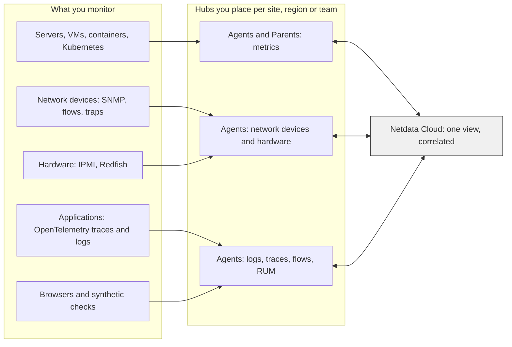
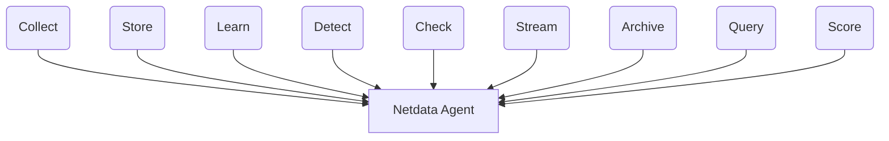

# netdata/netdata

Full-stack observability · Metrics · Logs · Traces · Flows · Topology · Infrastructure · APM · NPM · DBM · RUM · Synthetics · Cloud · AI SRE · OpenTelemetry · SNMP · NetFlow/IPFIX/sFlow · IPMI · Redfi

## features

| Area                                    | What you get                                                                                                     |
|-----------------------------------------|------------------------------------------------------------------------------------------------------------------|
| **Infrastructure monitoring**           | Systems, containers, Kubernetes, virtualization and hardware through 2,000+ integrations, per second             |
| **Application performance monitoring**  | Find any trace by ID, filter traces by any attribute, and see latency percentiles and errors for any slice of traffic, with service maps and browser sessions linked to backend traces. Traces stay on your infrastructure. |
| **Digital experience monitoring**       | Real user monitoring with Core Web Vitals and JavaScript errors, Playwright journeys, Lighthouse audits, uptime   |
| **Network performance monitoring**      | Zero-configuration SNMP with 1,750+ device profiles, L2/L3 topology, NetFlow/IPFIX/sFlow, SNMP traps, BGP         |
| **Database monitoring**                 | 50+ databases and managed services, with live top-query views on 12 engines                                     |
| **Logs monitoring**                     | systemd-journal, Windows Event Log and macOS unified logs queried in place on every node, with no shipping or extra storage |
| **Logs management**                      | Collect logs from any source through OpenTelemetry and syslog, search every field, and explore with facets and histograms. Logs are acknowledged only once safely on disk and are searchable as they arrive, with retention and offload to your own S3 storage. |
| **Cloud monitoring**                    | 31 AWS services through CloudWatch, 38 Azure services through Azure Monitor, and Google Cloud                     |
| **Endpoint and edge monitoring**        | Windows, macOS, IoT and embedded devices with the same Agent                                                     |
| **Alerting**                            | 1,100+ stock alerts, your own alerts as code, from the UI or generated by AI, 30+ notification integrations      |
| **Machine learning and AI**             | Anomaly detection on every metric, Netdata AI investigations, MCP servers for any AI assistant                   |
| **Long-term retention**                 | About 0.6 bytes per sample, with tiered storage that keeps per-second, per-minute and per-hour history            |
| **Scalability**                         | Independent hubs (Parents for metrics; Agents for devices, logs, traces and flows) unified by Netdata Cloud, 100,000+ nodes |

---

## Netdata Ecosystem

This three-part architecture scales from a single node to fleets of 100,000+ nodes:

| Component         | Description                                                                                                                                                                                         | License                                         |
|-------------------|-----------------------------------------------------------------------------------------------------------------------------------------------------------------------------------------------------|-------------------------------------------------|
| **Netdata Agent** | • Core engine: collection, storage, machine learning, alerting, streaming, export • Also a hub: Parents for metrics; Agents for SNMP, flows, traps, logs and traces • Runs on servers, cloud, Kubernetes, Windows, macOS and edge devices • MCP server built in | [GPL v3+](https://www.gnu.org/licenses/gpl-3.0) |
| **Netdata Cloud** | • Unifies and correlates all hubs in one view • Netdata AI, traces explorer, Network Monitor, digital experience and uptime views • RBAC, SSO, SCIM • SaaS or Enterprise On-Prem • Free community tier • Data stays on your infrastructure |                                                 |
| **Netdata UI**    | •

## installation

You can install Netdata on all major operating systems. To begin:

### 1. Install Netdata

Choose your platform and follow the installation guide:

* [Linux Installation](https://learn.netdata.cloud/docs/installing/one-line-installer-for-all-linux-systems)
* [macOS](https://learn.netdata.cloud/docs/installing/macos)
* [FreeBSD](https://learn.netdata.cloud/docs/installing/freebsd)
* [Windows](https://learn.netdata.cloud/docs/netdata-agent/installation/windows)
* [Docker Guide](/packaging/docker/README.md)
* [Kubernetes Setup](https://learn.netdata.cloud/docs/installation/install-on-specific-environments/kubernetes)

> [!NOTE]
> You can access the Netdata UI at `http://localhost:19999` (or `http://NODE:19999` if remote).

## configuration

Netdata auto-discovers most metrics, but you can manually configure some collectors:

* [All collectors](https://learn.netdata.cloud/docs/data-collection/)
* [SNMP monitoring](https://learn.netdata.cloud/docs/data-collection/monitor-anything/networking/snmp)

### 3. Configure Alerts

You can use 1,100+ stock alerts, add your own, and send notifications to:

`email`, `Slack`, `Telegram`, `PagerDuty`, `Discord`, `Microsoft Teams`, and more.

> [!NOTE]  
> Email alerts work by default if there's a configured MTA.

### 4. Configure Parents

You can centralize dashboards, alerts, and storage with Netdata Parents:

* [Streaming Reference](https://learn.netdata.cloud/docs/streaming/streaming-configuration-reference)

> [!NOTE]  
> You can use Netdata Parents for central dashboards, longer retention, and alert configuration.

### 5. Connect to Netdata Cloud

[Sign in to Netdata Cloud](https://app.netdata.cloud/sign-in) and connect your nodes for:

* Access from anywhere
* Horizontal scalability and multi-node dashboards
* UI configuration for alerts and data collection
* Role-based access control
* Free tier available

> [!NOTE]  
> Netdata Cloud is optional. Your data stays in your infrastructure.

## Live Demo Sites

  <b>See Netdata in action</b> 
  <a href="https://frankfurt.netdata.rocks"><b>FRANKFURT</b></a> |
  <a href="https://newyork.netdata.rocks"><b>NEWYORK</b></a> |
  <a href="https://atlanta.netdata.rocks"><b>ATLANTA</b></a> |
  <a href="https://sanfrancisco.netdata.rocks"><b>SANFRANCISCO</b></a> |
  <a href="https://toronto.netdata.rocks"><b>TORONTO</b></a> |
  <a href="https://singapore.netdata.rocks"><b>SINGAPORE</b></a> |
  <a href="https://bangalore.netdata.rocks"><b>BANGALORE</b></a>
   
  <i>These demo clusters run with default configuration and show real monitoring data.</i>
   
  <i>Choose the instance closest to you for the best performance.</i>

---

## How It Works

Netdata Agents collect, store, analyze and alert where data is created. Hubs concentrate each kind of data where you choose, and Netdata Cloud unifies them into one view.

* **Agents** run on every system and collect, store, analyze and alert where the data is created.
* **Hubs** concentrate each kind of data where you choose. They are independent: capacity grows by adding hubs, and a problem in one hub stays in that hub.
* **Netdata Cloud** routes every query to the hubs that hold the answer and correlates the results into one view. It is not in the data path.

### Inside every Agent

With each Agent you can:

1. **Collect** – Gather metrics from systems, containers, apps, logs, APIs, and synthetic checks.
2. **Store** – Save metrics to a high-efficiency, tiered time-series database.
3. **Learn** – Train ML models per metric using recent behavior.
4. **Detect** – Identify anomalies using trained ML models.
5. **Check** – Evaluate metrics against pre-set or custom alert rules.
6. **Stream** – Send metrics to Netdata Parents in real time.
7. **Archive** – Export metrics to Prometheus, InfluxDB, OpenTSDB, Graphite, and others.
