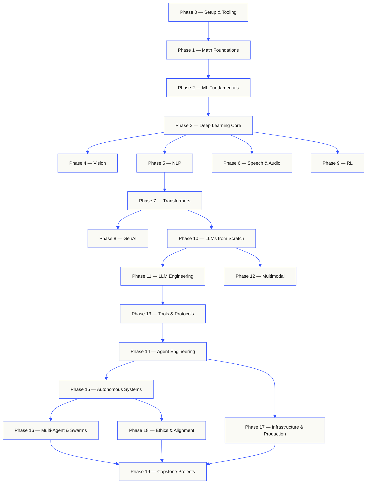

# rohitg00/ai-engineering-from-scratch

Learn AI Engineering! Learn it. Build it. Ship it for others.

## features

A framework call hides the part that breaks. When a loss turns into NaN or an agent repeats the same tool call, the person who wrote the small version knows where to look. Most lessons have you write that small version first and run it, then show where production tools do the same work.

  <picture>
    <source media="(max-width: 600px) and (prefers-color-scheme: dark)" srcset="assets/readme/lesson-loop-mobile-dark.svg">
    <source media="(max-width: 600px)" srcset="assets/readme/lesson-loop-mobile-light.svg">
    <source media="(prefers-color-scheme: dark)" srcset="assets/readme/lesson-loop-dark.svg">
    
  </picture>

Text version

- **01 · THE PROBLEM**: An LLM returns text. It cannot act.
- **02 · BUILD IT**: A ReAct loop in stdlib Python.
- **03 · USE IT**: Where agent SDKs run the same loop.
- **04 · SHIP IT**: skill-agent-loop.md, ready for your agent.

## Learning paths

| Route | Starting lesson |
|---|---|
| Model foundations | [Setup and tooling](https://aiengineeringfromscratch.com/learn/setup-and-tooling/dev-environment) |
| LLM systems | [Prompt engineering](https://aiengineeringfromscratch.com/learn/llm-engineering/prompt-engineering) |
| Agents and delivery | [The agent loop](https://aiengineeringfromscratch.com/learn/agent-engineering/the-agent-loop) |

[Compare career paths](https://aiengineeringfromscratch.com/learning-paths.html) · [Prerequisites and study time](#study-guide)

### Gradient descent

Twenty starting points follow gradient descent on a quadratic loss. The graph shows their positions and mean loss after each update.

  <a href="https://aiengineeringfromscratch.com/learn/math-foundations/optimization#loss-landscape-visualization">
    <picture>
      <source media="(max-width: 600px) and (prefers-color-scheme: dark) and (prefers-reduced-motion: reduce)" srcset="assets/readme/101-gradient-mobile-dark.png">
      <source media="(max-width: 600px) and (prefers-reduced-motion: reduce)" srcset="assets/readme/101-gradient-mobile-light.png">
      <source media="(prefers-color-scheme: dark) and (prefers-reduced-motion: reduce)" srcset="assets/readme/101-gradient-dark.png">
      <source media="(prefers-reduced-motion: reduce)" srcset="assets/readme/101-gradient-light.png">
      <source media="(max-width: 600px) and (prefers-color-scheme: dark)" srcset="assets/readme/101-gradient-mobile-dark.gif">
      <source media="(max-width: 600px)" srcset="assets/readme/101-gradient-mobile-light.gif">
      <source media="(prefers-color-scheme: dark)" srcset="assets/readme/101-gradient-dark.gif">
      
    </picture>
  </a>

[Adjust the learning rate in the lesson](https://aiengineeringfromscratch.com/learn/math-foundations/optimization#loss-landscape-visualization) · [Compare GD, momentum, and Adam in code](phases/01-math-foundations/08-optimization/code/optimizers.py)

### Projects

Three projects with staged starters, reference implementations, and local graders. Run commands from the repository root after [setup](#local-setup). Starters fail until you implement the stages.

<strong>01 · Retrieval Evaluation Lab</strong> · Python · Ranking metrics and regression checks

A candidate improves mean NDCG while one query ranks its most relevant evidence lower. Build a query-by-query comparison that reports the regression and can fail

## requirements

- You can write code (any language; Python helps).
- You want to understand how AI **actually works**, not just call APIs.

## Where to start

| Background | Start at | Estimated time |
|---|---|---|
| New to programming and AI | Phase 0 — Setup | ~306 hours |
| Know Python, new to ML | Phase 1 — Math Foundations | ~270 hours |
| Know ML, new to deep learning | Phase 3 — Deep Learning Core | ~200 hours |
| Know deep learning, want LLMs and agents | Phase 10 — LLMs from Scratch | ~100 hours |
| Senior engineer, only want agent engineering | Phase 14 — Agent Engineering | ~60 hours |
| Only want to build production MCP systems | [Model Context Protocol (MCP) path](learning-paths/model-context-protocol.json) | ~23 hours 15 min |
| Only want to build production Agent Skills | [Agent Skills Engineering path](learning-paths/agent-skills.json) | ~9.5 hours |
| Only want to learn reverse engineering | [Reverse Engineering path](learning-paths/reverse-engineering.json) | ~32.5 hours |

## The shape of the curriculum

Twenty phases stack on top of each other. Math is the floor. Agents and production are the roof.
Skip ahead if you already know the lower layers, but don't skip and then wonder why something at
the top is breaking.

  <picture>
    <source media="(max-width: 600px) and (prefers-color-scheme: dark)" srcset="assets/readme/curriculum-map-mobile-dark.svg">
    <source media="(max-width: 600px)" srcset="assets/readme/curriculum-map-mobile-light.svg">
    <source media="(prefers-color-scheme: dark)" srcset="assets/readme/curriculum-map-dark.svg">
    
  </picture>

Phase dependency graph

## Contents

Twenty phases. Click any phase to expand its lesson list.

## installation

> Get your environment ready for everything that follows.

| # | Lesson | Type | Lang |
|:---:|--------|:----:|------|
| 01 | [Dev Environment](phases/00-setup-and-tooling/01-dev-environment/) | Build | Python, TypeScript, Rust |
| 02 | [Git & Collaboration](phases/00-setup-and-tooling/02-git-and-collaboration/) | Learn | — |
| 03 | [GPU Setup & Cloud](phases/00-setup-and-tooling/03-gpu-setup-and-cloud/) | Build | Python |
| 04 | [APIs & Keys](phases/00-setup-and-tooling/04-apis-and-keys/) | Build | Python, TypeScript |
| 05 | [Jupyter Notebooks](phases/00-setup-and-tooling/05-jupyter-notebooks/) | Build | Python |
| 06 | [Python Environments](phases/00-setup-and-tooling/06-python-environments/) | Build | Shell |
| 07 | [Docker for AI](phases/00-setup-and-tooling/07-docker-for-ai/) | Build | Docker |
| 08 | [Editor Setup](phases/00-setup-and-tooling/08-editor-setup/) | Build | — |
| 09 | [Data Management](phases/00-setup-and-tooling/09-data-management/) | Build | Python |
| 10 | [Terminal & Shell](phases/00-setup-and-tooling/10-terminal-and-shell/) | Learn | — |
| 11 | [Linux for AI](phases/00-setup-and-tooling/11-linux-for-ai/) | Learn | — |
| 12 | [Debugging & Profiling](phases/00-setup-and-tooling/12-debugging-and-profiling/) | Build | Python |
| 13 | [Python for AI Engineering](phases/00-setup-and-tooling/13-python-for-ai-engineering/) | Build | Python, TypeScript |

<b>Phase 1 — Math Foundations</b> &nbsp;<code>22 lessons</code>&nbsp; <em>The intuition behind every AI algorithm, through code.</em>

 

| # | Lesson | Type | Lang |
|:---:|--------|:----:|------|
| 01 | [Linear Algebra Intuition](phases/01-math-foundations/01-linear-algebra-intuition/) | Learn | Python, Julia |
| 02 | [Vectors, Matrices & Operations](phases/01-math-foundations/02-vectors-matrices-operations/) | Build | Python, Julia |
| 03 | [Matrix Transformations & Eigenvalues](phases/01-math-foundations/03-matrix-transformations/) | Build | Python, Julia |
| 04 | [Calculus for ML: Derivatives & Gradients](phases/01-math-foundations/04-calculus-for-ml/) | Learn | Python, Julia |
| 05 | [Chain Rule & Automatic Differentiation](phases/01-math-foundations/05-chain-rule-and-autodiff/) | Build | Python, Julia |
| 06 | [Probability & Distributions](phases/01-math-foundations/06-probability-and-distributions/) | Learn | Python, Julia |
| 07 | [Bayes' Theorem & Statistical Thinking](phases/01-math-foundations/07-bayes-theorem/) | Build | Python, TypeScript |
| 08 | [Optimization: Gradient Descent Family](phases/01-math-foundations/08-optimization/) | Build | Python, Julia |
| 09 | [Information Theory: Entropy, KL Divergence](phases/01-math-foundations/09-information-theory/) | Learn | Python, TypeScript |
| 10 | [Dimensionality Reduction: PCA, t-SNE, UMAP](phases/01-math-foundations/10-dimensionality-reduction/) | Build | Python, TypeScript, Julia |
| 11 | [Singular Value Decomposition](phases/01-math-foundations/11-singular-value-decomposition/) | Build | Python, Julia |
| 12 | [Tensor Operations](phases/01-math-foundations/12-tensor-operations/) | Build | Python, TypeScript |
| 13 | [Numerical Stability](phases/01-math-foundations/13-numerical-stability/) | Build | Python, TypeScript, Julia |
| 14 | [Norms & Distances](phases/01-math-foundations/14-norms-and-distances/) | Build | Python, TypeScript |
| 15 | [Statistics for ML](phases/01-math-foundations/15-statistics-for-ml/) | Build | Python, TypeScript |
| 16 | [Sampling Methods](phases/01-math-foundations/16-sampling-methods/) | Build | Python, TypeScript, Julia |
| 17 | [Linear Systems](phases/01-math-foundations/17-linear-systems/) | Build | Python, TypeScript, Julia |
| 18 | [Convex Optimization](phases/01-math-foundations/18-convex-optimization/) | Build | Python, TypeScript, Julia |
| 19 | [Complex Numbers for AI](phases/01-math-foundations/19-complex-numbers/) | Learn | Python, TypeScript |
| 20 | [The Fourier Transform](phases/01-math-foundations/20-fourier-
